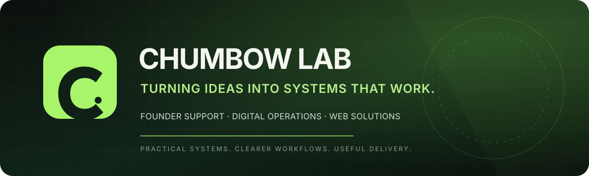

<!--
  Paul Chumbow | GitHub profile
  Brand: Chumbow Lab
  Focus: founder support, digital operations, WordPress and practical AI workflows.
-->

  

  <a href="https://paulchumbow254.lovable.app">PORTFOLIO</a> &nbsp;·&nbsp;
  <a href="https://www.linkedin.com/in/paul-chumbow">LINKEDIN</a> &nbsp;·&nbsp;
  <a href="mailto:paulchumbow254@gmail.com?subject=Project%20or%20workflow%20enquiry">CONTACT</a>

# Hello, I’m Paul Chumbow.

I work at the intersection of **founder support, digital operations and practical technology**. I help make work clearer and more manageable through thoughtful coordination, useful digital tools, well-built websites and carefully applied AI workflows.

**Chumbow Lab** is the working identity behind this portfolio: *Turning Ideas Into Systems That Work.*

## What do I help make easier?

| Focus | What that looks like |
|---|---|
| **Founder & executive support** | Calendar and task coordination, meeting preparation, follow-through, documentation and operational visibility |
| **Digital operations** | Process mapping, hand-offs, trackers, repeatable workflows and practical systems |
| **WordPress & web solutions** | Website implementation, child-theme customisation, maintenance, WooCommerce support and SEO foundations |
| **Practical AI & automation** | AI-assisted research, drafting, workflow experiments and human-reviewed process improvements |

## What can you explore here?

### Property Operations — maintenance coordination prototype

A browser-based prototype exploring how landlords and property managers in Kenya can organise maintenance reports, urgency, assignments, progress, completion notes and costs.

- **Stack:** HTML, CSS and vanilla JavaScript.
- **Current scope:** browser-local records, CSV export and JSON backup.
- **Important limitation:** no hosted backend or shared multi-user storage.

[Explore the repository](https://github.com/chumbowlab/chumbow-lab-property-operations) · [Use the maintenance workflow template](https://github.com/chumbowlab/chumbow-lab-property-operations/blob/main/resources/MAINTENANCE-WORKFLOW-TEMPLATE.md)

### CMFI Kenya — WordPress website project

A live website project for Christian Missionary Fellowship International Kenya, covering WordPress implementation, child-theme styling, responsive presentation, content structure, SEO foundations and site operations.

[Read the project case study](./projects/cmfi-kenya/README.md) · [Visit cmfikenya.com](https://cmfikenya.com)

### Founder Operations Hub — founder-support workspace prototype

A lightweight workspace for daily briefs, task tracking, meetings, follow-ups and weekly reviews.

- **Stack:** HTML, CSS and vanilla JavaScript.
- **Current scope:** browser-local data, CSV task export, calendar-file export and JSON backup.
- **Important limitation:** live Google Workspace integrations, authentication and cloud synchronisation are not implemented.

[Explore the project](./projects/founder-operations-hub/README.md)

### Operations & automation toolkit — reusable resources

A growing, openly documented collection of practical templates and workflow patterns for founder support, digital operations and small teams.

[Explore the toolkit](./resources/operations-automation-toolkit/README.md)

## How do I approach a new problem?

1. **Understand the context:** identify the people, goals, steps, hand-offs and information involved.
2. **Find the friction:** distinguish the underlying problem from symptoms and unnecessary complexity.
3. **Choose a proportionate solution:** improve the process first, then introduce tools where they add value.
4. **Build and document:** make the workflow understandable, maintainable and appropriate to its actual scope.
5. **Review honestly:** use feedback and evidence to decide what to improve next.

## What principles guide my work?

- Useful before complicated.
- Clear ownership and follow-through.
- Responsible handling of information and access.
- Human oversight where AI is involved.
- Transparent project status and limitations.
- Evidence before claims.

## What am I building and learning?

I’m continuing to develop practical work across operations, WordPress, web applications and AI-assisted workflows. This profile will grow as projects become ready to share—with clear documentation, real screenshots and accurate status labels.

## Have a workflow or website project to discuss?

If you need support with founder operations, digital coordination, a WordPress website or a practical business tool, send a short outline of the challenge.

**[Email Paul about a project](mailto:paulchumbow254@gmail.com?subject=Project%20or%20workflow%20enquiry)** · [View my portfolio](https://paulchumbow254.lovable.app)

I aim to respond to genuine enquiries within **one business day**.

---

  Paul Chumbow · Chumbow Lab · Nairobi, Kenya 
  Turning Ideas Into Systems That Work.

