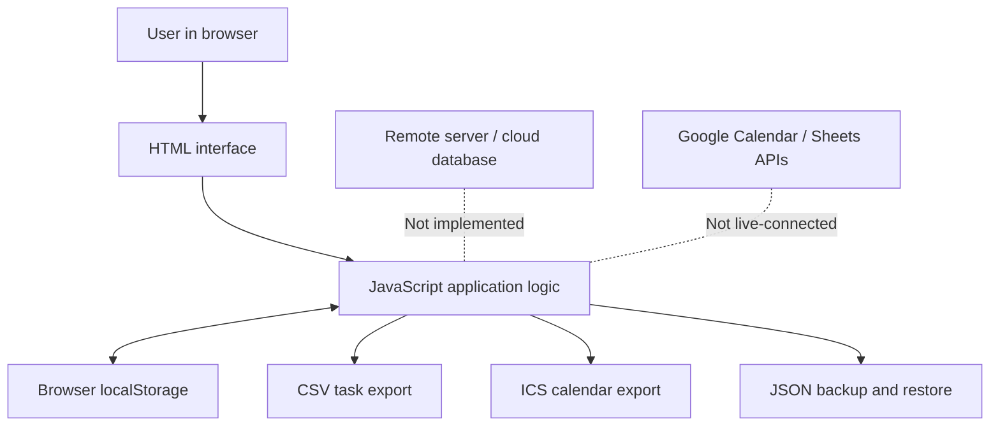

# Founder Operations Hub — Architecture

This document describes the current browser-only prototype. It is intentionally limited to what is implemented.

## System overview

## Current components

| Component | Responsibility |
|---|---|
| HTML | Page structure and interface elements |
| CSS | Layout, visual styling and responsive presentation |
| Vanilla JavaScript | Task, meeting, follow-up and weekly-review interactions |
| localStorage | Persists data in the current browser profile |
| CSV export | Creates a file containing task records |
| ICS export | Creates a calendar file for import into a calendar application |
| JSON backup | Exports and restores the local workspace data |

## Data lifecycle

1. A user enters or changes a record in the browser.
2. The application updates its in-memory interface state.
3. The workspace is persisted in browser localStorage.
4. The user can export selected data as CSV or ICS, or create a JSON backup.
5. A JSON backup can be restored in a browser session using the provided restore workflow.

The prototype does not transmit workspace records to a server.

## Trust boundaries and limitations

- Browser storage is scoped to the browser profile and device.
- There is no account system or identity verification.
- There is no server-side access control or shared workspace.
- Browser localStorage should not be treated as encrypted or secure storage for sensitive information.
- Exported files can be copied or shared outside the application; users are responsible for handling them appropriately.
- No live Google Workspace API connection exists.

## Future architecture considerations

A connected version would require a deliberate design for authentication, authorisation, server-side validation, secure storage, backups, audit history, data retention, API consent, sync conflicts and recovery. These capabilities should be designed and tested before introducing real client or business data.

---
**Status:** Architecture notes for prototype v1.0. Update this document when implementation changes.
